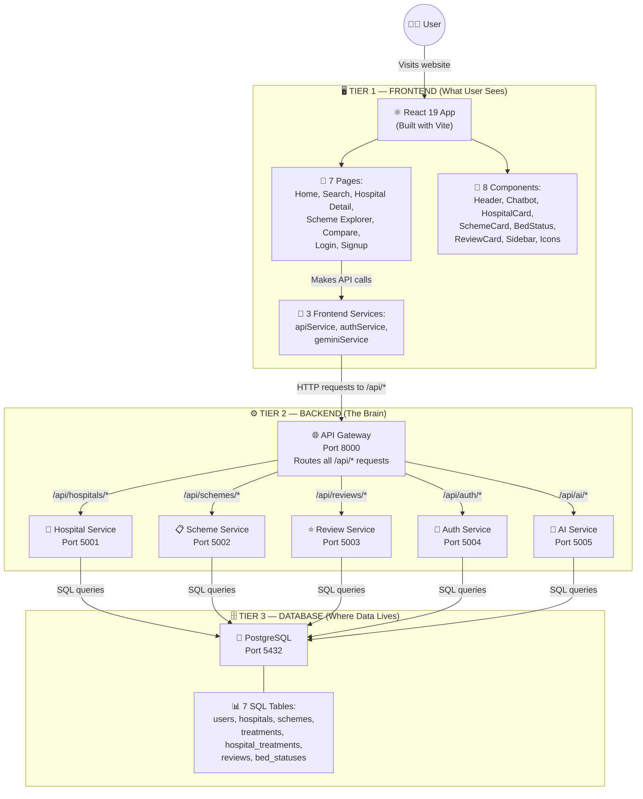
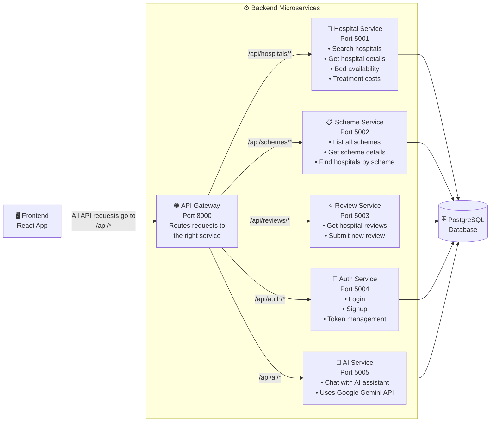
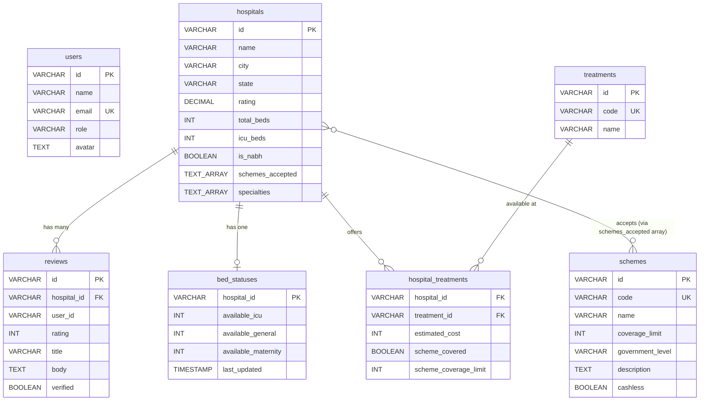
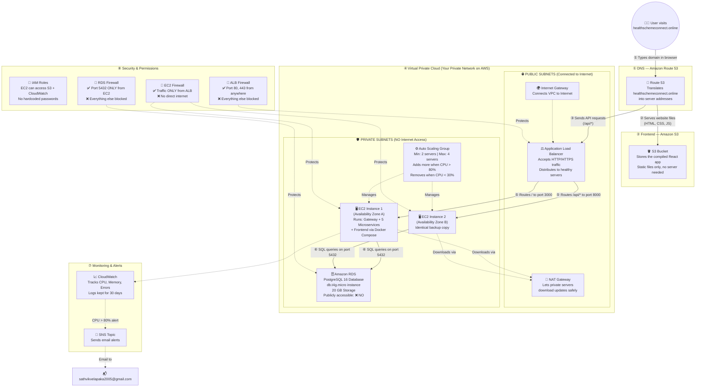

# 🏥 Health Scheme Connect — Complete Architecture

> **Domain:** `healthschemeconnect.online` | **Tech:** React 19 + Node.js + PostgreSQL + AWS

---

## 📋 Table of Contents
1. [Full System Overview](#-full-system-overview)
2. [Frontend (What the User Sees)](#-tier-1--frontend--presentation-layer)
3. [Backend (The Brain)](#-tier-2--backend--microservices-layer)
4. [Database (Where Data Lives)](#-tier-3--database--data-layer)
5. [AWS Deployment (How It Goes Live)](#-aws-deployment--how-it-goes-live)
6. [Security (How It Stays Safe)](#-security--how-it-stays-safe)
7. [Complete Request Flow](#-complete-request-flow)

---

## 🗺️ Full System Overview



---

## 🖥️ TIER 1 — Frontend (Presentation Layer)

> **Tech:** React 19 + TypeScript + Tailwind CSS + Vite  
> **Runs on:** Port 3000 locally → Amazon S3 in production

### Pages (What Users Navigate To)

| Page | File | What It Does |
|------|------|-------------|
| 🏠 Home | `HomePage.tsx` | Landing page with search bar, featured hospitals, scheme stats |
| 🔍 Search Results | `SearchResultsPage.tsx` | Shows filtered hospitals by city + scheme |
| 🏥 Hospital Detail | `HospitalDetailPage.tsx` | Full hospital info: beds, treatments, reviews, schemes |
| 📋 Scheme Explorer | `SchemeExplorerPage.tsx` | Browse all government health schemes |
| ⚖️ Compare | `ComparePage.tsx` | Side-by-side hospital comparison |
| 🔐 Login | `LoginPage.tsx` | User login with email/password |
| 📝 Signup | `SignupPage.tsx` | New user registration |

### Components (Reusable UI Pieces)

| Component | What It Does |
|-----------|-------------|
| `Header.tsx` | Navigation bar, theme toggle, language switcher |
| `Chatbot.tsx` | AI-powered health assistant (uses Gemini) |
| `HospitalCard.tsx` | Hospital preview card in search results |
| `SchemeCard.tsx` | Government scheme info card with details |
| `BedStatusTile.tsx` | Real-time ICU/General/Maternity bed availability |
| `ReviewCard.tsx` | Patient review display with star ratings |
| `HospitalSidebar.tsx` | Quick info sidebar on hospital detail page |
| `icons.tsx` | Custom SVG icon library |

### Frontend Services (How Frontend Talks to Backend)

| Service | What It Does |
|---------|-------------|
| `apiService.ts` | Calls backend APIs for hospitals, schemes, reviews, beds, treatments |
| `authService.ts` | Handles login, signup, logout, guest login + stores tokens |
| `geminiService.ts` | Sends chat messages to the AI service |

---

## ⚙️ TIER 2 — Backend (Microservices Layer)

> **Tech:** Node.js + Express + TypeScript  
> **Pattern:** Microservices Architecture with API Gateway



### API Endpoints Summary

| Service | Endpoint | Method | What It Does |
|---------|----------|--------|-------------|
| Hospital | `/api/hospitals` | GET | Search hospitals (filter by city, scheme) |
| Hospital | `/api/hospitals/:id` | GET | Get one hospital's full details |
| Hospital | `/api/hospitals/:id/beds` | GET | Get real-time bed availability |
| Hospital | `/api/hospitals/:id/treatments` | GET | Get treatment costs + scheme coverage |
| Scheme | `/api/schemes` | GET | List all government health schemes |
| Scheme | `/api/schemes/:id/hospitals` | GET | Find hospitals that accept a scheme |
| Review | `/api/reviews/:hospitalId` | GET | Get reviews for a hospital |
| Review | `/api/reviews` | POST | Submit a new review |
| Auth | `/api/auth/login` | POST | Login with email + password |
| Auth | `/api/auth/signup` | POST | Register new user |
| AI | `/api/ai/chat` | POST | Send message to AI chatbot |

---

## 🗄️ TIER 3 — Database (Data Layer)

> **Tech:** PostgreSQL 16  
> **Runs on:** Port 5432 locally (Docker) → Amazon RDS in production



### Database Tables Summary

| Table | Rows (Seeded) | Purpose |
|-------|:---:|---------|
| `users` | 2 | Admin and regular user accounts |
| `hospitals` | 10+ | Hospital info: name, city, beds, ratings, schemes accepted |
| `schemes` | 8+ | Government health schemes (PMJAY, CGHS, etc.) |
| `treatments` | 15+ | List of medical treatments (CABG, Dialysis, etc.) |
| `hospital_treatments` | 50+ | Maps treatment → hospital with costs + scheme coverage |
| `reviews` | 20+ | Patient reviews with star ratings |
| `bed_statuses` | 10+ | Real-time ICU, General, Maternity bed counts |

---

## ☁️ AWS Deployment — How It Goes Live



### All 12 AWS Services Used

| # | AWS Service | What It Does | Layer |
|:-:|------------|-------------|-------|
| 1 | **Route 53** | DNS — maps `healthschemeconnect.online` to your servers | Domain |
| 2 | **S3 Bucket** | Hosts static React frontend (HTML/CSS/JS) | Frontend |
| 3 | **VPC** | Creates your own private network in the cloud | Network |
| 4 | **Public Subnets (x2)** | Internet-facing zone for ALB + NAT | Network |
| 5 | **Private Subnets (x2)** | Hidden zone for EC2 + RDS (no internet) | Network |
| 6 | **Internet Gateway** | Connects VPC to the internet | Network |
| 7 | **NAT Gateway** | Lets private servers download updates safely | Network |
| 8 | **Application Load Balancer** | Distributes traffic across EC2 instances | Routing |
| 9 | **EC2 + Auto Scaling Group** | Runs your Docker containers (2–4 servers) | Compute |
| 10 | **RDS (PostgreSQL 16)** | Managed SQL database, auto-backups | Database |
| 11 | **CloudWatch** | Monitors CPU, logs errors, triggers alarms | Monitoring |
| 12 | **SNS** | Sends email alerts when something breaks | Alerts |
| 13 | **IAM** | Secure permissions (no hardcoded passwords) | Security |
| 14 | **Security Groups (x3)** | Firewall rules for ALB, EC2, and RDS | Security |

### Terraform Files (Infrastructure as Code)

| File | What It Creates |
|------|----------------|
| `provider.tf` | Sets AWS region to `us-east-1`, environment to `production` |
| `vpc.tf` | VPC + 2 Public Subnets + 2 Private Subnets + IGW + NAT |
| `security-groups.tf` | 3 firewalls (ALB, EC2, RDS) |
| `loadbalancer.tf` | ALB + Target Groups + Listener Rules (`/` → port 3000, `/api/*` → port 8000) |
| `autoscaling.tf` | EC2 Launch Template + Auto Scaling Group (2–4 instances) |
| `rds.tf` | PostgreSQL 16 database in private subnet |
| `iam.tf` | IAM roles so EC2 can access S3 + CloudWatch |
| `s3-sns-cloudwatch.tf` | S3 bucket + SNS alerts + CloudWatch alarms |
| `route53.tf` | DNS records for `healthschemeconnect.online` + `www` |

---

## 🔐 Security — How It Stays Safe

```
Internet
    │
    ▼
┌─────────────────────────────────────┐
│  🚧 ALB Security Group             │
│  ✅ Allows: Port 80, 443 (HTTP/S)  │
│  ❌ Blocks: Everything else         │
└──────────────┬──────────────────────┘
               │
               ▼
┌─────────────────────────────────────┐
│  🚧 EC2 Security Group             │
│  ✅ Allows: Traffic ONLY from ALB   │
│  ❌ Blocks: Direct internet access  │
│  ✅ Allows: EC2-to-EC2 (internal)   │
└──────────────┬──────────────────────┘
               │
               ▼
┌─────────────────────────────────────┐
│  🚧 RDS Security Group             │
│  ✅ Allows: Port 5432 from EC2 only │
│  ❌ Blocks: Everything else         │
│  ❌ Publicly accessible: NO         │
└─────────────────────────────────────┘
```

> **Key Point:** A hacker on the internet can ONLY reach the Load Balancer. They cannot directly access your servers or database. Each layer only trusts the layer directly above it.

---

## 🔄 Complete Request Flow

Here's what happens when a user opens `healthschemeconnect.online` and searches for hospitals:

```
 STEP 1: User types healthschemeconnect.online in browser
           │
           ▼
 STEP 2: Route 53 DNS resolves the domain name
           │
           ├──→ Static files? → S3 serves React app (HTML/CSS/JS)
           │
           ▼
 STEP 3: React app loads in the user's browser
           │
           ▼
 STEP 4: User searches "Hospitals in Hyderabad with PMJAY"
           │
           ▼
 STEP 5: React calls → /api/hospitals?city=Hyderabad&schemeCode=PMJAY
           │
           ▼
 STEP 6: Route 53 sends API request to ALB (Load Balancer)
           │
           ▼
 STEP 7: ALB sees /api/* → forwards to EC2 port 8000 (Gateway)
           │
           ▼
 STEP 8: Gateway sees /api/hospitals → forwards to Hospital Service (port 5001)
           │
           ▼
 STEP 9: Hospital Service runs SQL query:
          SELECT * FROM hospitals
          WHERE LOWER(city) = 'hyderabad'
          AND 'PMJAY' = ANY(schemes_accepted)
          ORDER BY rating DESC
           │
           ▼
 STEP 10: PostgreSQL returns matching hospital rows
           │
           ▼
 STEP 11: Response travels back:
           RDS → Hospital Service → Gateway → ALB → User's Browser
           │
           ▼
 STEP 12: React renders beautiful hospital cards on screen! ✅
```
